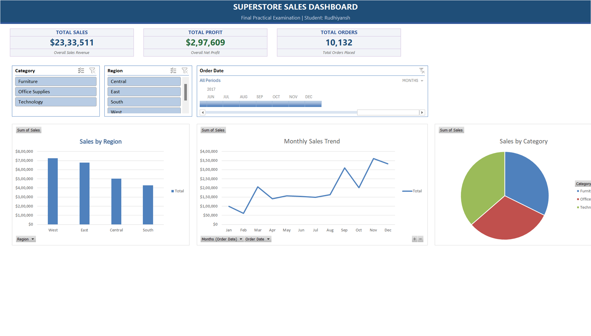
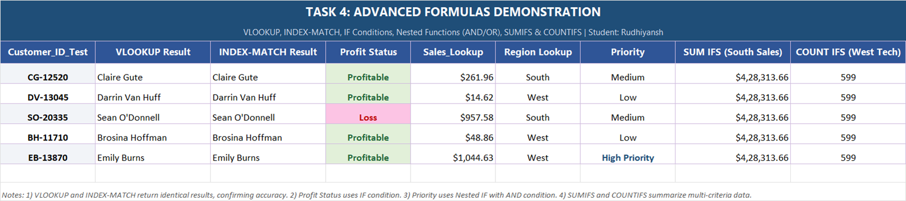
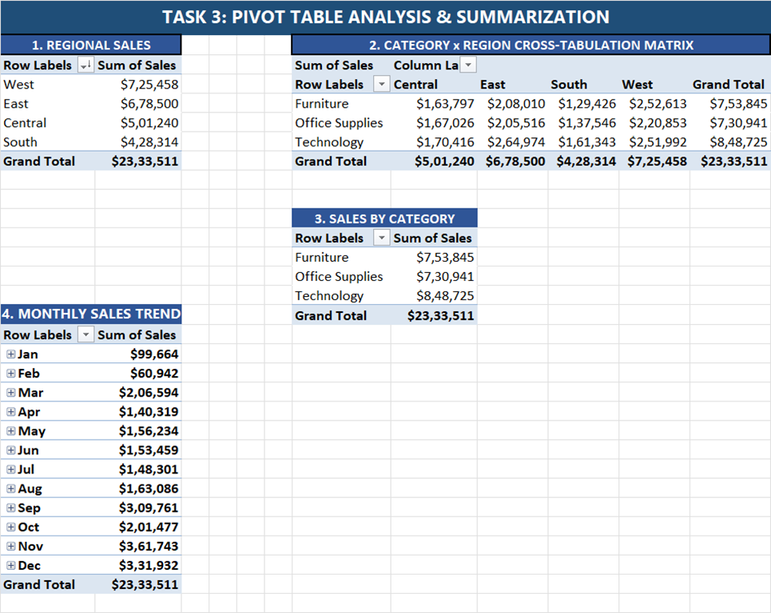

# Rudhiyansh_ExcelDashboard.xlsx

An interactive sales analytics dashboard and practical examination project built with Microsoft Excel, featuring dynamic Pivot Tables, multi-criteria advanced formulas, interactive slicers, timeline filtering, and structured table data.



---

## Table of Contents
- [Overview](#overview)
- [Workbook Structure](#workbook-structure)
- [Tools / Requirements](#tools--requirements)
- [Getting Started](#getting-started)
- [Features & Tasks Covered](#features--tasks-covered)
- [Sample Formulas & Output](#sample-formulas--output)
- [Assumptions Made](#assumptions-made)
- [Project Structure](#project-structure)
- [Author](#author)
- [License](#license)

---

## Overview

This project was developed for an academic practical examination assignment based on the official evaluation rubric. The objective is to analyze retail transaction data from a Superstore dataset containing 10,132 sales records, clean and structure the data, build dynamic Pivot Tables for business insights, demonstrate proficiency in advanced Excel formulas, and assemble an executive interactive dashboard with visual charts, slicers, and timeline filtering.

The project demonstrates end-to-end data processing in Excel: from raw tabular data cleaning to advanced formula modeling, cross-tabulation matrix summarization, and interactive dashboard UI design.

---

## Workbook Structure

The workbook file `Rudhiyansh_ExcelDashboard.xlsx` consists of five organized sheets:

| Sheet Name | Content & Purpose |
| :--- | :--- |
| **`Instructions`** | Student-level documentation detailing sheet purposes, table naming conventions, data assumptions, and slicer report connection mapping. |
| **`Dashboard`** | Executive presentation canvas featuring 3 KPI cards (`Total Sales`, `Total Profit`, `Total Orders`), 2 Slicers (`Category`, `Region`), 1 Timeline (`Order Date`), and 3 linked Pivot Charts. Clean solid white canvas with hidden gridlines. |
| **`data`** | Master transaction database formatted as an official Excel Table named `data`. Contains 10,132 verified rows across 25 attributes with standardized number and date formats. |
| **`Pivot Analysis`** | Analytical workspace hosting 4 distinct Pivot Tables (`PivotTable1`, `PivotTable2`, `PivotTable4`, `PivotTable3`) and 3 standalone analytical Pivot Charts. |
| **`Formulas`** | Formula testing and demonstration workspace evaluating lookup functions, logical conditions, multi-criteria nested statements, and aggregation formulas against live customer records. |

### Table Information
- **Table Name**: `data`
- **Total Records**: 10,132 rows (Headers in Row 1, data spanning rows 2 to 10,133)
- **Attributes (25 Columns)**: `Order ID`, `State`, `Order Date`, `Ship Date`, `Ship Mode`, `Customer ID`, `Customer Name`, `Segment`, `Country`, `City`, `Postal Code`, `Region`, `Prouct ID`, `Category`, `Sub-Category`, `Product Name`, `Sales`, `Quantity`, `Discount`, `Discount value`, `Profit`, `COGS`, `Shipping time range`, `Year sales`, `Shipping cost per unit`.

---

## Tools / Requirements

- **Application**: Microsoft Excel 2016, 2019, 2021, or Microsoft 365 (Desktop or Excel Online).
- **Core Excel Features Used**:
  - Structured Excel Tables (`data[...]` syntax)
  - Pivot Tables & Pivot Charts
  - Interactive Slicers (`Category`, `Region`)
  - Timeline Control (`Order Date`)
  - Multi-Pivot Report Connections (Slicer Cache Connections)
  - Advanced Lookup & Reference Formulas (`VLOOKUP`, `INDEX`, `MATCH`)
  - Logical & Conditional Functions (`IF`, `AND`, `SUMIFS`, `COUNTIFS`)
  - Conditional Formatting (soft green/red indicator fills)
  - Data Type Formatting (Currency `$#,##0.00`, Date `YYYY-MM-DD`, Integer `#,##0`)

---

## Getting Started

Follow these steps to open, inspect, and interact with the workbook:

1. **Download / Clone the Repository**:
   ```bash
   git clone https://github.com/rudhiyansh/Rudhiyansh_ExcelDashboard.git
   ```
2. **Open the Workbook**:
   - Open `Rudhiyansh_ExcelDashboard.xlsx` in Microsoft Excel.
   - If prompted by Excel with a yellow Protected View banner, click **Enable Editing**.
3. **Using the Interactive Dashboard**:
   - Navigate to the **`Dashboard`** sheet.
   - Click on any button in the **Category** slicer (`Furniture`, `Office Supplies`, `Technology`) or **Region** slicer (`Central`, `East`, `South`, `West`) to filter all charts simultaneously.
   - Use the **Order Date** timeline slider to filter transactions across specific years, quarters, or months.
   - Clear slicer filters by clicking the filter icon with the red cross (`Alt + C`) in the top-right corner of each slicer header.
4. **Refreshing Data (If Modifying Records)**:
   - If new rows are added to the `data` table, go to the **Data** tab on the Excel ribbon and click **Refresh All** (or press `Ctrl + Alt + F5`) to update all Pivot Tables, charts, and dashboard KPI metrics.

---

## Features & Tasks Covered

Every task specified in the assignment evaluation rubric has been fully implemented in the workbook:

| Sr. No. | Task Description | Skills Tested | Weightage | Implementation Sheet & Location | Implementation Summary |
| :---: | :--- | :--- | :---: | :--- | :--- |
| **1** | **Dataset Selection & Import** | Data Import, Initial Cleaning | 5% | Sheet `data` | Imported Superstore transaction dataset into an official structured Excel Table named `data`. Verified header integrity across all 25 columns. |
| **2** | **Data Cleaning & Preparation** | Remove duplicates, Handle missing values, Format data types | 10% | Sheet `data`<br>`A1:Y10133` | Purged 20,229 empty ghost rows; validated zero null/missing values; applied standard Currency (`$#,##0.00`), Date (`Short Date`), and Number (`#,##0`) formats across all columns. |
| **3** | **Create Pivot Tables** | Data Analysis, Summarization | 15% | Sheet `Pivot Analysis`<br>`Rows 1:30` | Built 4 distinct Pivot Tables: Regional Sales (`PivotTable1`), Category x Region Matrix (`PivotTable2`), Sales by Category (`PivotTable4`), and Monthly Sales Seasonality Trend (`PivotTable3`). |
| **4** | **Advanced Formulas** | VLOOKUP, INDEX-MATCH, IF conditions, nested functions | 15% | Sheet `Formulas`<br>`Rows 3:8` | Implemented `VLOOKUP`, `INDEX-MATCH`, `IF` (Profit Status), Nested `IF` with `AND` (Priority Logic), `SUMIFS` (South Sales), and `COUNTIFS` (West Technology Orders) on real customer records. |
| **5** | **Data Visualization** | Charts, Conditional Formatting | 20% | Sheet `Dashboard`<br>Sheet `Pivot Analysis` | Embedded 3 styled Pivot Charts (Regional Bar Chart, Monthly Trend Line Chart, Category Distribution Chart) and applied conditional formatting rules for visual status tracking. |
| **6** | **Interactive Dashboard** | Slicers, Timeline, Dynamic ranges | 25% | Sheet `Dashboard`<br>`Rows 1:35` | Designed an executive dashboard with 3 KPI cards, 2 Slicers (`Category`, `Region`), and 1 Timeline (`Order Date`) wired via Report Connections to all Pivot Tables. Removed gridlines for a clean presentation canvas. |
| **7** | **Documentation** | Sheet organization, Naming conventions, Instructions | 10% | Sheet `Instructions` | Authored clear documentation covering sheet descriptions, table naming rules, neutral data assumptions, and interactive filter guides. |

---

## Sample Formulas & Output

All formulas in the workbook reference live records in structured table `data`. Below are the real formulas and real evaluated values extracted directly from the workbook:

### 1. Executive Dashboard KPI Formulas (Sheet: `Dashboard`)

| KPI Metric | Excel Formula | Evaluated Value | Formatted Display |
| :--- | :--- | :--- | :--- |
| **Total Sales** | `=SUM(data[Sales])` | `2333511.2383` | **`$2,333,511`** |
| **Total Profit** | `=SUM(data[Profit])` | `297608.7771` | **`$297,609`** |
| **Total Orders** | `=COUNTA(data[Order ID])` | `10132` | **`10,132`** |

---

### 2. Advanced Formula Testing (Sheet: `Formulas`)

Demonstrated on real customer IDs extracted from the dataset:

| Formula Type | Target Customer ID | Exact Formula Implemented | Real Evaluated Output |
| :--- | :---: | :--- | :--- |
| **`VLOOKUP`** | `CG-12520` | `=VLOOKUP(A4, data[[Customer ID]:[Customer Name]], 2, FALSE)` | `Claire Gute` |
| **`INDEX-MATCH`** | `CG-12520` | `=INDEX(data[Customer Name], MATCH(A4, data[Customer ID], 0))` | `Claire Gute` |
| **Logical `IF`** | `CG-12520` | `=IF(INDEX(data[Profit], MATCH(A4, data[Customer ID], 0))>0, "Profitable", "Loss")` | `Profitable` |
| **Logical `IF` (Loss Case)** | `SO-20335` | `=IF(INDEX(data[Profit], MATCH(A6, data[Customer ID], 0))>0, "Profitable", "Loss")` | `Loss` |
| **Nested `IF` with `AND`** | `EB-13870` | `=IF(AND(E8>500, F8="West"), "High Priority", IF(E8>200, "Medium", "Low"))` | `High Priority` *(Sales: $1,044.63, Region: West)* |
| **Nested `IF` with `AND`** | `CG-12520` | `=IF(AND(E4>500, F4="West"), "High Priority", IF(E4>200, "Medium", "Low"))` | `Medium` *(Sales: $261.96, Region: South)* |
| **Nested `IF` with `AND`** | `DV-13045` | `=IF(AND(E5>500, F5="West"), "High Priority", IF(E5>200, "Medium", "Low"))` | `Low` *(Sales: $14.62, Region: West)* |
| **`SUMIFS`** | Region = "South" | `=SUMIFS(data[Sales], data[Region], "South")` | **`$428,313.66`** |
| **`COUNTIFS`** | West & Technology | `=COUNTIFS(data[Region], "West", data[Category], "Technology")` | **`599`** |

#### Formulas Sheet Preview


---

### 3. Pivot Table Summaries (Sheet: `Pivot Analysis`)

- **PivotTable1 (Regional Sales)**:
  - West: `$725,457.82`
  - East: `$678,499.87`
  - Central: `$501,239.89`
  - South: `$428,313.66`
  - **Grand Total**: **`$2,333,511.24`**
- **PivotTable4 (Sales by Category)**:
  - Technology: `$848,724.67`
  - Furniture: `$753,845.26`
  - Office Supplies: `$730,941.30`
  - **Grand Total**: **`$2,333,511.24`**
- **PivotTable3 (Monthly Trend Peak)**:
  - Peak Month: November (`$361,742.97`), followed by December (`$331,932.04`) and September (`$309,760.79`).

#### Pivot Analysis Sheet Preview


---

## Assumptions Made

The following neutral assumptions and business rules were applied during project execution:

1. **Missing Data**: Verification confirmed zero blank or missing cells in primary analytical fields (`Sales`, `Profit`, `Order Date`, `Region`, `Category`). All 10,132 transaction rows were retained.
2. **Duplicate Handling**: Duplicate row verification was conducted across all transaction columns using Excel's Table Data Tools. Exactly 20,229 empty ghost rows beyond row 10,133 were purged to optimize file performance and prevent pivot cache bloat.
3. **Profit Status Classification**: Defined strictly as:
   - `Profitable`: `Profit > 0`
   - `Loss`: `Profit <= 0`
4. **Customer Priority Logic**: Multi-criteria priority tiering is defined as:
   - `High Priority`: `Sales > $500` **AND** `Region = "West"`
   - `Medium`: `Sales > $200` (regardless of region)
   - `Low`: All remaining transactions (`Sales <= $200`)
5. **Report Connections**: Slicers (`Category`, `Region`) and the Timeline (`Order Date`) are linked via Report Connections to all three primary pivot caches to ensure synchronized cross-filtering across the dashboard.

---

## Project Structure

```
Rudhiyansh_ExcelDashboard/
│
├── Rudhiyansh_ExcelDashboard.xlsx          # Main Excel workbook
│   ├── Instructions                         # Documentation & assumptions
│   ├── Dashboard                            # Executive interactive dashboard
│   ├── data                                 # Cleaned raw dataset (Table: data)
│   ├── Pivot Analysis                       # 4 Pivot tables & analytical charts
│   └── Formulas                             # Formula tests & demonstration
│
├── screenshots/
│   ├── dashboard.png                        # Actual screenshot of Dashboard sheet
│   ├── pivot_analysis.png                   # Actual screenshot of Pivot Analysis sheet
│   └── formulas.png                         # Actual screenshot of Formulas sheet
│
└── README.md                                # Project documentation
```

---

## Author

- **Name**: Rudhiyansh
- **GitHub**: [@rudhiyansh](https://github.com/rudhiyansh)
- **Course / Assignment**: Excel Practical Examination Project

---

## License

This project is licensed under the [MIT License](LICENSE) for academic and educational demonstration purposes.
